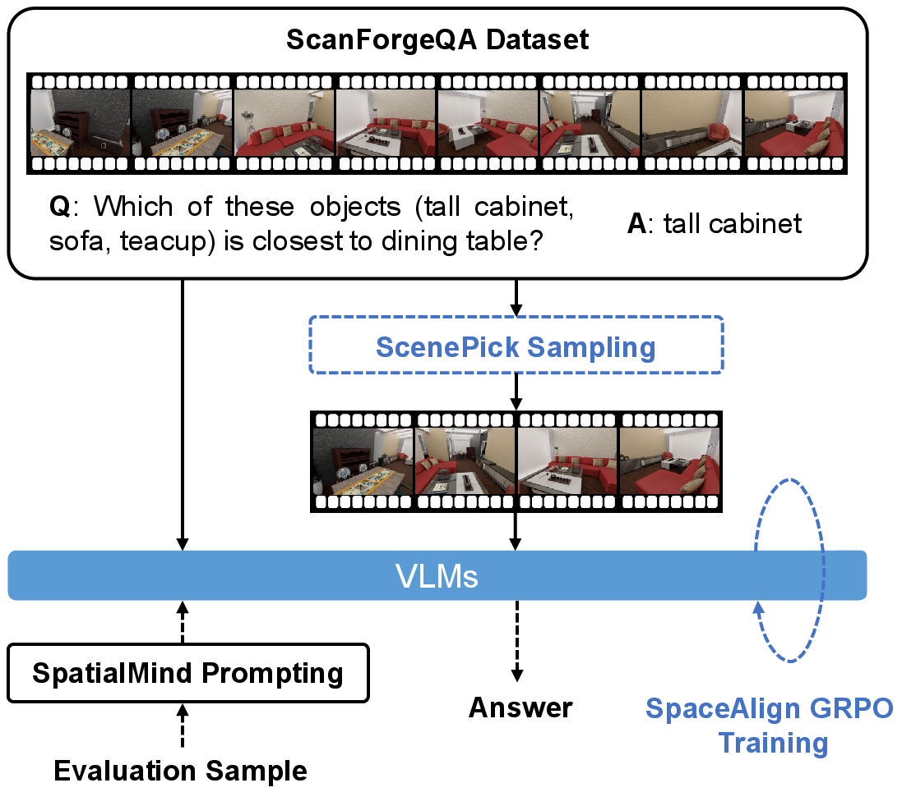
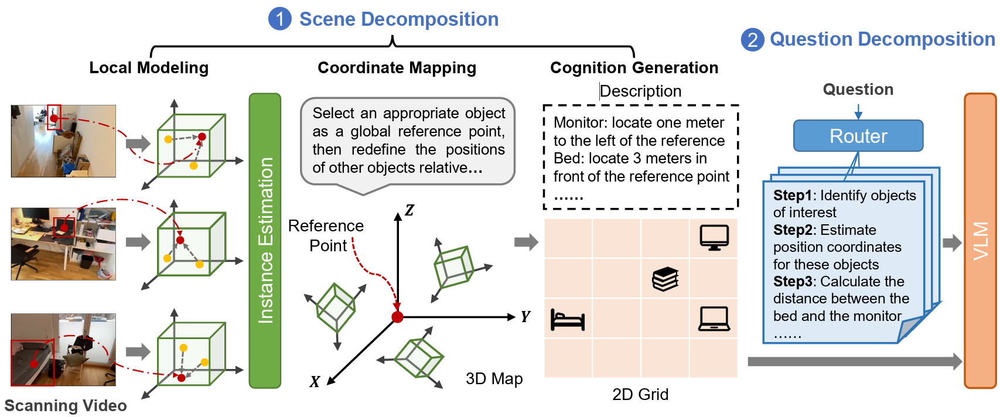
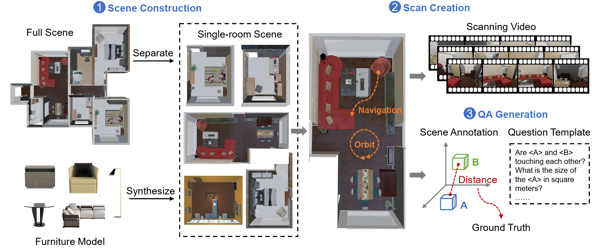
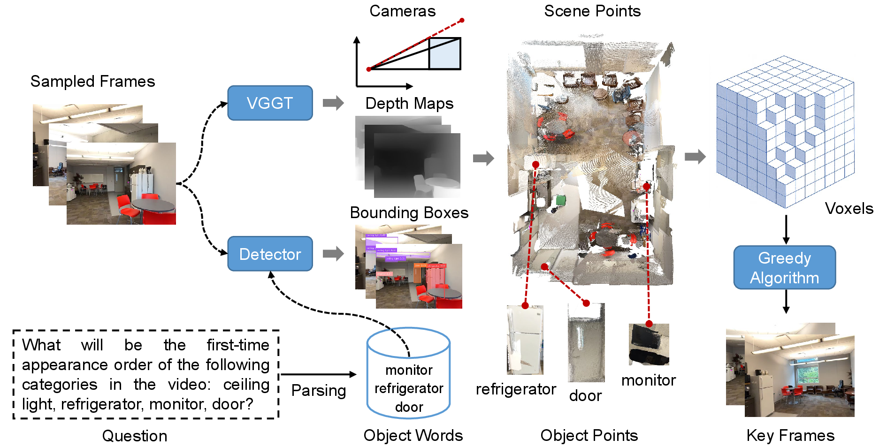

<div align="center">

# 🌌 SpaceEra / SpaceEra++

### Conference Paper

**[Spatial Understanding from Videos: Structured Prompts Meet Simulation Data](https://proceedings.neurips.cc/paper_files/paper/2025/hash/9541101fbc2f24bce5f2462b95db88c4-Abstract-Conference.html)**<br>
*NeurIPS 2025 Spotlight*

<p>
  Haoyu Zhang<sup>1,2</sup>, Meng Liu<sup>3,4</sup>, Zaijing Li<sup>1,2</sup>, Haokun Wen<sup>1</sup>,<br>
  Weili Guan<sup>1</sup>, Yaowei Wang<sup>1,2</sup>, Liqiang Nie<sup>1</sup>
</p>

<p><sub>
  <sup>1</sup> Harbin Institute of Technology (Shenzhen) ·
  <sup>2</sup> Pengcheng Laboratory<br>
  <sup>3</sup> Shandong Jianzhu University ·
  <sup>4</sup> Zhongguancun Academy
</sub></p>

### Journal Paper

**[SpaceEra++: A Unified Framework Towards 3D Spatial Reasoning in Video](https://doi.org/10.1109/TPAMI.2026.3692302)**<br>
*Accepted by IEEE Transactions on Pattern Analysis and Machine Intelligence (TPAMI), 2026 · Early Access*

<p>
  Weili Guan<sup>1,2</sup>, Haoyu Zhang<sup>1,3</sup>, Meng Liu<sup>4,5</sup>,<br>
  Qianlong Xiang<sup>1,6,2</sup>, Yaowei Wang<sup>1,4</sup>, Liqiang Nie<sup>1</sup>
</p>

<p><sub>
  <sup>1</sup> Harbin Institute of Technology (Shenzhen) ·
  <sup>2</sup> Shenzhen Loop Area Institute<br>
  <sup>3</sup> Pengcheng Laboratory ·
  <sup>4</sup> Shandong University<br>
  <sup>5</sup> Zhongguancun Academy ·
  <sup>6</sup> City University of Hong Kong
</sub></p>

<p>
  <code>SpatialMind</code> ·
  <code>ScanForgeQA</code> ·
  <code>ScenePick</code> ·
  <code>SpaceAlign</code>
</p>

[Overview](#-overview) · [Installation](#-installation) · [Training](#-training) · [Inference](#-inference) · [Methods](#-method-components) · [Citation](#-citation)

</div>

---

## 🔭 Overview

This repository contains the code for both versions of SpaceEra:

| Version | Venue | Main components | Purpose |
| --- | --- | --- | --- |
| **SpaceEra** | NeurIPS 2025 Spotlight | SpatialMind, ScanForgeQA | Structured inference and synthetic spatial QA data |
| **SpaceEra++** | IEEE TPAMI 2026, accepted | ScenePick, SpaceAlign | Informative frame selection and spatially constrained GRPO |

<div align="center">
  
  <p><em>Unified SpaceEra++ framework for data construction, frame sampling, training, and inference.</em></p>
</div>

The integrated workflow is:

```text
Training
ScanForgeQA ──► ScenePick ──► Vision-Language Model ──► SpaceAlign GRPO

Inference
Video sample ──► ScenePick ──► SpatialMind ──► Vision-Language Model ──► Answer
```

> [!NOTE]
> The commands below use **`Qwen/Qwen2.5-VL-7B-Instruct` as a reference example**. It can be replaced through `--model` with another Transformers/TRL-compatible vision-language model. Depending on the architecture, adjust the processor/media loader and `--lora-target-modules` accordingly.

## ✨ What is included

| Component | Stage | Implementation |
| --- | --- | --- |
| 🧠 **SpatialMind** | Inference | Scene decomposition and question decomposition prompts |
| 🏗️ **ScanForgeQA** | Data | Scene construction, scan creation, and spatial QA generation |
| 🎞️ **ScenePick** | Input | VGGT reconstruction, semantic voxel weighting, and greedy frame selection |
| 🎯 **SpaceAlign** | Training | Format, task, absolute-coordinate, and relative-relation rewards |
| 🔗 **Integrated workflow** | End to end | ScanForgeQA adapters, cached preprocessing, GRPO training, and VLM inference |

## 🗂️ Repository structure

```text
.
├── asset/                              # Paper figures
├── examples/
│   ├── scene0277_02.mp4                # Example scanning video
│   ├── scene_spec.json                 # Scene construction example
│   ├── grounding_boxes.json            # ScenePick semantic boxes
│   ├── scanforgeqa_training_sample.jsonl
│   └── spacealign_reward.json
├── scripts/
│   ├── prepare_scanforgeqa.py           # ScanForgeQA -> ScenePick cache
│   ├── train_spacealign.py              # SpaceAlign GRPO training
│   └── infer_spaceera.py                # ScenePick + SpatialMind inference
├── src/spaceera/
│   ├── scanforgeqa/                     # Conference: dataset construction
│   ├── spatialmind/                     # Conference: prompting
│   ├── scenepick/                       # Journal: frame selection
│   ├── spacealign/                      # Journal: spatial rewards
│   ├── workflows/                       # Integrated data and prompt pipeline
│   ├── schemas.py
│   └── cli.py
├── tests/
├── max_coverage_cal_batch.py            # Legacy ScenePick entry point
├── max_coverage_cal.py                  # Legacy alias
└── pyproject.toml
```

## ⚙️ Installation

### Basic SpaceEra components

```bash
python3 -m pip install -e .
```

### Complete training and inference stack

```bash
python3 -m pip install -e '.[scenepick,training]'
```

Python 3.10 or newer is recommended. The complete stack includes PyTorch, Transformers, TRL, PEFT, Datasets, and Qwen vision utilities. It pins `trl==0.21.0`; PyTorch SDPA is used by default, while Flash Attention remains optional.

ScenePick additionally expects the official [VGGT](https://github.com/facebookresearch/vggt) package to be importable as `vggt`:

```bash
git clone https://github.com/facebookresearch/vggt.git
cd vggt
python3 -m pip install -e .
```

VGGT weights can be provided as a Hugging Face model ID such as `facebook/VGGT-1B` or as a local checkpoint directory.

> [!TIP]
> Grounded SAM 2 is optional. Without question-specific grounding boxes, ScenePick runs the spatial-coverage-only variant.

## 🚀 Training

The training path is deliberately split into a deterministic ScenePick preparation stage and a model-training stage. This prevents VGGT reconstruction from being repeated in every epoch.

### 1. Prepare ScanForgeQA records

Training accepts JSON or JSONL. A canonical sample looks like:

```json
{
  "sample_id": "scene0001_qa0001",
  "video_path": "videos/scene0001.mp4",
  "question": "What is the distance between the sofa and table?",
  "answer": "2.0 meters",
  "question_type": "absolute_distance",
  "selected_frames": [],
  "ground_truth_coordinates": {
    "sofa": [2, 3],
    "table": [6, 3]
  },
  "category_counts": {
    "sofa": 1,
    "table": 1
  },
  "grounding_boxes": {}
}
```

Required fields are `video_path`, `question`, and `answer`.

- `selected_frames` may be empty; ScenePick will populate it.
- `ground_truth_coordinates` enables the complete SpaceAlign spatial rewards.
- If `scene_graph_path` is provided instead, 10×10 grid coordinates are derived automatically.
- `grounding_boxes` enables question-aware semantic weighting.
- Common aliases such as `video`, `source_video`, `qa_id`, `problem`, and `solution` are accepted.

Run cached ScenePick preprocessing:

```bash
python3 scripts/prepare_scanforgeqa.py \
  --dataset /path/to/scanforgeqa_train.jsonl \
  --video-root /path/to/ScanForgeQA \
  --vggt-model facebook/VGGT-1B \
  --num-frames 32 \
  --max-candidates 64 \
  --output outputs/scanforgeqa_train_scenepick.jsonl
```

Questions sharing the same video reuse one VGGT reconstruction. Only one video's dense point maps are retained in memory at a time.

### 2. Train with SpaceAlign GRPO

The following command uses Qwen2.5-VL-7B-Instruct as an example backbone:

```bash
accelerate launch scripts/train_spacealign.py \
  --dataset outputs/scanforgeqa_train_scenepick.jsonl \
  --model Qwen/Qwen2.5-VL-7B-Instruct \
  --output-dir outputs/spacealign-qwen2.5-vl-7b \
  --num-generations 4 \
  --batch-size 1 \
  --gradient-accumulation-steps 8 \
  --dtype bfloat16
```

The example configuration applies LoRA to `q_proj` and `v_proj`. For another backbone:

```bash
--model organization/another-vlm \
--lora-target-modules q_proj k_proj v_proj o_proj
```

SpaceAlign trains the model to return:

```text
<spatial_map>{"object": [x, y]}</spatial_map>
<think>spatial reasoning</think>
<answer>final answer</answer>
```

The four reward components are logged independently:

| Reward | Function |
| --- | --- |
| `R_format` | Checks the required response structure |
| `R_task` | Scores multiple-choice, text, or numerical correctness |
| `R_abs` | Measures normalized object-coordinate accuracy |
| `R_rel` | Measures pairwise direction and distance consistency |

An unprepared dataset can also be passed directly to `train_spacealign.py`; add `--vggt-model` and ScenePick will run before training.

Validate records without loading model weights:

```bash
python3 scripts/train_spacealign.py \
  --dataset outputs/scanforgeqa_train_scenepick.jsonl \
  --dry-run
```

> [!IMPORTANT]
> GRPO generates multiple completions for every visual prompt and is substantially more memory-intensive than SFT. Use an Accelerate/DeepSpeed configuration appropriate for the available GPUs.

## 🔮 Inference

Inference combines ScenePick-selected frames with a SpatialMind prompt and the chosen vision-language model.

### Prepared sample

```bash
python3 scripts/infer_spaceera.py \
  --dataset outputs/scanforgeqa_train_scenepick.jsonl \
  --sample-id scene0001_qa0001 \
  --model Qwen/Qwen2.5-VL-7B-Instruct \
  --adapter outputs/spacealign-qwen2.5-vl-7b \
  --output outputs/prediction.json
```

Omit `--adapter` to use the original backbone. Replace `--model` to evaluate another compatible VLM.

### Raw sample without selected frames

Add ScenePick parameters:

```bash
python3 scripts/infer_spaceera.py \
  --dataset /path/to/raw_samples.jsonl \
  --sample-id scene0001_qa0001 \
  --vggt-model facebook/VGGT-1B \
  --num-frames 32 \
  --max-candidates 64 \
  --model Qwen/Qwen2.5-VL-7B-Instruct \
  --output outputs/prediction.json
```

When `scene_graph_path` is available, SpatialMind includes its structured scene representation. Otherwise, it instructs the VLM to perform local modeling, coordinate mapping, cognition generation, and question decomposition directly from the selected frames.

Inspect the complete model input without loading VLM weights:

```bash
python3 scripts/infer_spaceera.py \
  --dataset outputs/scanforgeqa_train_scenepick.jsonl \
  --sample-id scene0001_qa0001 \
  --dry-run \
  --output outputs/inference_input.json
```

## 🧩 Method components

### 🧠 SpatialMind prompting

SpatialMind decomposes spatial reasoning into two coordinated stages:

1. **Scene decomposition**: local modeling, coordinate mapping, and cognition generation.
2. **Question decomposition**: classify the spatial task and construct explicit reasoning steps.

<div align="center">
  
  <p><em>SpatialMind structured prompting strategy.</em></p>
</div>

The implementation supports relative distance, object count, appearance order, relative direction, object size, absolute distance, room size, and route planning.

### 🏗️ ScanForgeQA construction

ScanForgeQA provides a three-stage synthetic data pipeline:

1. **Scene construction** from structured room and object specifications.
2. **Scan creation** using orbit and navigation camera trajectories.
3. **QA generation** from scene geometry and object annotations.

<div align="center">
  
  <p><em>ScanForgeQA dataset construction pipeline.</em></p>
</div>

Minimal conference-version example:

```bash
spaceera build-scene \
  --scene-spec examples/scene_spec.json \
  --output outputs/scene_graph.json

spaceera build-scan \
  --scene-graph outputs/scene_graph.json \
  --output outputs/scan_sequence.json \
  --blender-script outputs/scan_camera.py

spaceera generate-qa \
  --scene-graph outputs/scene_graph.json \
  --video-path /path/to/rendered_scan.mp4 \
  --output outputs/qa_pairs.json
```

Supplying `--video-path` writes the video and scene-graph references required by integrated training.

### 🎞️ ScenePick sampling

ScenePick combines geometric coverage with question-related object semantics:

1. Uniformly pre-sample candidate frames.
2. Reconstruct depth, camera poses, and 3D points with VGGT.
3. Ground question-related objects and assign semantic weights.
4. Voxelize valid 3D points.
5. Greedily maximize weighted coverage.

<div align="center">
  
  <p><em>ScenePick frame sampling strategy.</em></p>
</div>

Run it directly on the included video:

```bash
spaceera scenepick \
  --video-dir examples/scene0277_02.mp4 \
  --model facebook/VGGT-1B \
  --num-frames 32 \
  --max-candidates 64 \
  --output outputs/scene0277_02_scenepick.json
```

For semantic sampling, add:

```bash
--grounding-json examples/grounding_boxes.json
```

Grounding JSON uses `{frame_name_or_path: [[x1, y1, x2, y2], ...]}`. Without it, all points receive equal weight and the command reproduces the spatial-coverage-only ablation.

### 🎯 SpaceAlign rewards

Core reward functions are available from `spaceera.spacealign`, while TRL-compatible batch adapters live in `spaceera.spacealign.trl_rewards`.

Evaluate the standalone example:

```bash
spaceera spacealign-reward \
  --input examples/spacealign_reward.json \
  --output outputs/reward.json
```

## 🧰 Utility commands

- `reason_steps.py`: inspect question decomposition.
- `gen_scene_exp.py`: inspect scene decomposition.
- `nav_script.py`: export an example Blender camera path.
- `max_coverage_cal_batch.py`: backward-compatible ScenePick entry point.


## 📚 Citation

### Conference version

```bibtex
@inproceedings{NEURIPS2025_9541101f,
  author    = {Zhang, Haoyu and Liu, Meng and Li, Zaijing and Wen, Haokun and Guan, Weili and Wang, Yaowei and Nie, Liqiang},
  booktitle = {Advances in Neural Information Processing Systems},
  editor    = {D. Belgrave and C. Zhang and H. Lin and R. Pascanu and P. Koniusz and M. Ghassemi and N. Chen},
  pages     = {103202--103229},
  publisher = {Curran Associates, Inc.},
  title     = {Spatial Understanding from Videos: Structured Prompts Meet Simulation Data},
  url       = {https://proceedings.neurips.cc/paper_files/paper/2025/file/9541101fbc2f24bce5f2462b95db88c4-Paper-Conference.pdf},
  volume    = {38},
  year      = {2025}
}
```

### Journal extension

```bibtex
@article{guan2026spaceerapp,
  author  = {Guan, Weili and Zhang, Haoyu and Liu, Meng and Xiang, Qianlong and Wang, Yaowei and Nie, Liqiang},
  journal = {IEEE Transactions on Pattern Analysis and Machine Intelligence},
  title   = {SpaceEra++: A Unified Framework Towards 3D Spatial Reasoning in Video},
  year    = {2026},
  pages   = {1--15},
  doi     = {10.1109/TPAMI.2026.3692302}
}
```

## 🙏 Acknowledgements

We thank the authors of [VSI-Bench](https://github.com/vision-x-nyu/thinking-in-space), [VGGT](https://github.com/facebookresearch/vggt), Grounded SAM 2, Blender, Hugging Face Transformers/TRL, and LLaMA-Factory for their released tools and resources.
